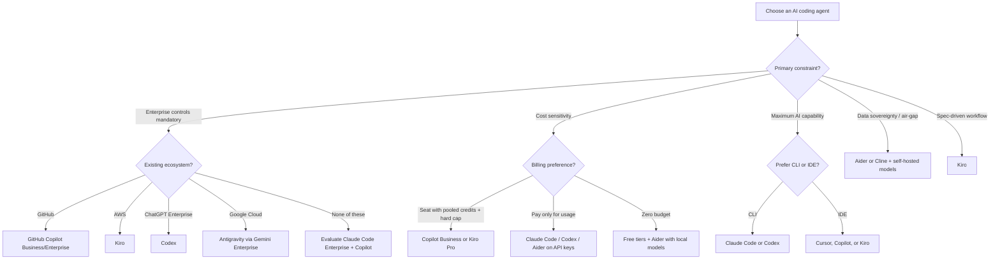

# AI Coding Agent Landscape

> A detailed comparison of current AI coding agents — capabilities, cost, enterprise readiness, and where each shines.

## How to Read This Page

This page compares agents across dimensions that matter for organizational decisions — not just "which one writes better code." We evaluate:

- **Capability** — What can it actually do?
- **Integration** — Where does it live in your workflow?
- **Enterprise readiness** — SSO, audit, data controls, admin features
- **Cost** — What does it really cost at scale?
- **Best for** — Where each tool has a genuine advantage

> ⚠️ **This landscape moves fast.** Tools release features weekly, prices change, and products get acquired or rebranded outright. In 2026 alone: Windsurf became Devin Desktop (June), Amazon Q Developer closed signups in favor of Kiro (May), Google replaced Gemini CLI with Antigravity CLI for consumer tiers (June), SpaceX acquired Cursor (August), and GitHub Copilot moved to usage-based billing (June). If something looks outdated, it probably is — check the vendor's current docs and consider contributing an update.
>
> **Pricing note:** Nearly every vendor now bills as *seat price + included usage credits + metered overage*. The seat price is the floor, not the total. Plan for usage, not just seats.

> **Last verified:** 2026-10-30 · **Re-check by:** 2027-01-30
>
> **Source of truth for coding-agent prices.** Vendor prices and plan details for coding agents live on this page only. Other pages use ranges and link here, so a price change is a one-page edit. See [Contributing](../CONTRIBUTING.md#keeping-time-sensitive-content-current).

---

## The Agents

### Claude Code (Anthropic)

**What it is:** Anthropic's coding agent, available as a CLI, IDE extensions (VS Code, JetBrains), desktop and web apps, and a cloud mode. Deep reasoning, multi-file awareness, and the ability to execute terminal commands.

| Dimension | Details |
|-----------|---------|
| **Mode** | CLI (primary), IDE extensions, desktop/web, cloud sessions |
| **Autonomy levels** | Plan mode → Ask before edits → Auto-accept edits → Bypass permissions (configurable) |
| **Multi-file** | Yes — reads, creates, edits across codebase |
| **Command execution** | Yes — runs tests, builds, linters, git |
| **Context window** | Depends on model; 1M-token context is available on current top-tier models |
| **Customization** | CLAUDE.md (can import `@AGENTS.md`), Agent Skills (SKILL.md), hooks, subagents, slash commands, plugins, MCP |
| **Enterprise controls** | Team/Enterprise: SSO, SCIM, audit logs, usage analytics, org-managed settings and permission policies |
| **Data handling** | No training on commercial (Team/Enterprise/API) data by default. Can run against Anthropic API, AWS Bedrock, or Google Vertex AI. Check specific plan terms. |

**Cost:**
| Tier | Price | What you get |
|------|-------|-------------|
| 💰 Pro | $20/month ($17 billed annually) | Individual use, lower limits |
| 💰 Max | $100 or $200/month | 5× or 20× Pro usage, for daily agent users |
| 💰 Team | Standard and Premium seats (~$20–25 and ~$100–125/seat/month), Claude Code on every seat | Central billing, SSO, admin controls |
| 🏢 Enterprise | ~$20/seat + usage at API rates (or negotiated) | SCIM, audit logs, compliance API |
| 💰 API | Pay-per-token, varies by model | Full control, scales with usage; also via Bedrock/Vertex |

**Best for:**
- Complex multi-step tasks requiring deep reasoning
- Large-scale refactoring
- Developers comfortable with CLI workflows
- Teams that want model-agnostic flexibility (via API)

**Watch out for:**
- Usage costs compound quickly on large tasks when billed at API rates (a complex refactor can be $5–20)
- CLI-first experience has a learning curve for IDE-native developers
- Context management on very large codebases requires thoughtful setup
- Reads CLAUDE.md, not AGENTS.md — if you standardize on AGENTS.md, add a one-line CLAUDE.md that imports it

---

### GitHub Copilot (Agent Mode)

**What it is:** GitHub's AI coding platform, evolved from autocomplete into IDE agent mode, a CLI, the Copilot app, and cloud agents that take an issue and open a PR — integrated deeply with VS Code and the GitHub ecosystem.

| Dimension | Details |
|-----------|---------|
| **Mode** | IDE (VS Code, Visual Studio, JetBrains, others), Copilot CLI, Copilot app, GitHub.com (cloud agent) |
| **Autonomy levels** | Autocomplete → Chat → Edit → Agent → Cloud agent (assign an issue, review the PR) |
| **Multi-file** | Yes (in agent mode) |
| **Command execution** | Yes (terminal commands in agent mode; cloud agent runs in a GitHub Actions-backed sandbox) |
| **Context window** | Varies by model selected (supports multiple vendors' models, plus automatic routing) |
| **Customization** | `.github/copilot-instructions.md`, `AGENTS.md`, path-scoped instructions, Agent Skills, MCP |
| **Enterprise controls** | Org/enterprise policies, content exclusion, audit logs, SSO via GitHub Enterprise, budgets at enterprise / cost-center / user level |
| **Data handling** | Business/Enterprise: no training on your code. Individual: check terms. Not available on GitHub Enterprise Server. |

**Cost (usage-based billing since June 1, 2026):** Each plan includes a monthly allowance of GitHub AI Credits, consumed by token usage at each model's published rate. Inline completions and next-edit suggestions don't consume credits. Copilot code review also consumes GitHub Actions minutes.

| Tier | Price | What you get |
|------|-------|-------------|
| 🆓 Free | $0 | 2,000 completions/month, a small credit allowance, auto model selection only |
| 💰 Pro | $10/month | Includes AI credits; cloud agent access |
| 💰 Pro+ | $39/month | Larger credit allowance, most advanced models |
| 💰 Max | $100/month | Highest individual credit allowance |
| 💰 Business | $19/user/month | Credits pooled across the org; policy controls; IP indemnity. Overage billed per credit or capped by budget |
| 🏢 Enterprise | $39/user/month | Larger pooled credits, enterprise-grade capabilities (requires GitHub Enterprise Cloud) |
| 🏢 Copilot access | $0 seat on GHE Cloud licenses, or $10/user standalone | Enterprise features with fully metered usage and no included credits |

**Best for:**
- Teams already in the GitHub ecosystem (repos, Actions, PRs)
- Organizations wanting a single vendor for code hosting + AI tooling
- Gradual adoption — progression from autocomplete to agent is smooth
- Enterprises requiring IP indemnification

**Watch out for:**
- Seat price is no longer the whole bill — heavy agent users can exhaust the pooled credits; set budgets before rollout
- Agent mode quality varies by model selection
- Tightly coupled to VS Code for full experience (other IDEs often get features later)
- Free tier is quite limited for meaningful agent exploration

---

### Amazon Q Developer — end-of-life, see Kiro

> ⚠️ **Status change:** Amazon Q Developer stopped accepting new signups in May 2026 and reaches full end-of-support in April 2027. AWS's designated successor is **Kiro** (profiled below). If you're evaluating AWS's coding-agent option today, evaluate Kiro directly — the entry below is kept only for teams still migrating off an existing Q Developer deployment.

**What it was:** AWS's AI coding assistant with deep integration into AWS services, IDE support, and agent capabilities for code transformation and generation — particularly strong for Java modernization and AWS-native workflows. If you have an existing Q Developer deployment, AWS's migration guidance points to Kiro for equivalent and expanded capability.

---

### Kiro (AWS / Amazon)

**What it is:** An AI-powered IDE built on VS Code with a focus on spec-driven development, and AWS's GA successor to Amazon Q Developer. Agents work from structured requirements through design to implementation via a spec workflow, alongside a conversational mode for less structured work.

| Dimension | Details |
|-----------|---------|
| **Mode** | IDE (VS Code-based), Kiro CLI (formerly Amazon Q Developer CLI), Kiro Web |
| **Autonomy levels** | Supervised (approve each change) → Autopilot (autonomous execution) → Autonomous mode in Kiro Web (assign a GitHub issue with the `kiro` label or a `/kiro` comment; Kiro works in a cloud environment and opens a PR) |
| **Multi-file** | Yes |
| **Command execution** | Yes |
| **Context window** | Dynamic model selection |
| **Customization** | Steering files (`.kiro/steering/`), `AGENTS.md` (workspace root or global steering), hooks, skills (SKILL.md), custom agents, MCP |
| **Enterprise controls** | SSO via AWS IAM Identity Center, Okta, or Microsoft Entra ID; prompt logging to an S3 bucket in your account; per-user activity export; model allow lists; hooks for access control; AWS GovCloud (US) availability |
| **Data handling** | AWS-backed infrastructure. Content isn't used to train foundation models on paid tiers; enterprise content isn't used for service improvement. IP indemnity for output on Pro, Pro+, Pro Max, and Power |

**Cost (credit-based; simple requests consume fractional credits, overage is opt-in):**
| Tier | Price | What you get |
|------|-------|-------------|
| 🆓 Free | $0 | 50 credits/month — enough to try the agent and spec workflow, not for daily use |
| 💰 Pro | $20/month | 1,000 credits |
| 💰 Pro+ | $40/month | 2,000 credits |
| 💰 Pro Max | $100/month | 5,000 credits |
| 💰 Power | $200/month | 10,000 credits |
| 🏢 Enterprise | Same tiers, billed per user | Org-wide governance, procurement via AWS |

**Best for:**
- AWS-heavy shops (Lambda, CDK, CloudFormation expertise baked in) migrating off Amazon Q Developer
- Teams wanting structured, spec-driven development (requirements → design → tasks)
- Organizations that value repeatability and auditability in AI-assisted work
- Those who want agent hooks and event-driven automation

**Watch out for:**
- Newer entrant than Copilot or Cursor — community and ecosystem still building
- Spec workflow has a learning curve (but enforces good practices)
- Enterprise controls are configured per AWS account and Region (a "Kiro profile"), which adds setup steps for multi-account organizations; IAM Identity Center instances using Multi-Region Replication aren't supported

---

### Cursor (SpaceX / xAI)

**What it is:** A fork of VS Code rebuilt around AI, with agent mode, cloud agents, multi-file editing, deep codebase indexing, and its own Composer models. **Ownership change:** SpaceX completed its acquisition of Cursor (Anysphere) on August 14, 2026. Since October 12, 2026, Cursor is sold as part of "The X Subscription", a single plan that bundles Cursor with Grok and X Premium. For existing Cursor Teams customers, SpaceXSI becomes the service provider when they accept the new terms.

| Dimension | Details |
|-----------|---------|
| **Mode** | IDE (Cursor editor — VS Code fork), CLI, cloud agents |
| **Autonomy levels** | Autocomplete → Chat → Agent → Cloud agents |
| **Multi-file** | Yes |
| **Command execution** | Yes (in agent mode) |
| **Context window** | Large (codebase indexing + model context) |
| **Customization** | `.cursor/rules/*.mdc`, `AGENTS.md`, Agent Skills, @-mentions for context (the older `.cursorrules` file is deprecated) |
| **Enterprise controls** | Privacy mode, SSO, admin and analytics (Teams); SCIM, audit logs, spend controls (Enterprise) |
| **Data handling** | Privacy mode available (no code stored). The contracting entity changed with the acquisition — re-check DPA and data-handling terms. |

**Cost (The X Subscription, from October 12, 2026):**
| Tier | Price | What you get |
|------|-------|-------------|
| 🆓 Free | $0 | Agent with limited requests |
| 💰 Plus | $8/month | Grok and Cursor's own models only |
| 💰 Premium | $30/month | Third-party models (billed separately at API list price), cloud agents, code review |
| 💰 Super / Ultra | $100 / $200 per month | ~15× / ~50× Plus usage |
| 💰 Teams | From $30/seat (Premium, Super, or Ultra seats) | SSO, admin, analytics |
| 🏢 Enterprise | Custom | Pooled usage, SCIM, audit logs, spend controls |

*Legacy Pro / Pro+ / Ultra / Teams ($40 and $120 seats) plans remain available to existing subscribers. Third-party model usage (Claude, GPT, Gemini) is not included in any tier's price.*

**Best for:**
- Developers who want AI integrated at every level of the IDE experience
- Fast iteration cycles — the feedback loop is tight
- Teams willing to adopt a new IDE (the switching cost is real but low since it's VS Code-based)
- Individual productivity (the "feel" of coding with Cursor is distinctly different)

**Watch out for:**
- **Vendor change:** new owner, new contracting entity, new bundled plan. Have legal and security re-review terms before renewing or expanding, and watch how product direction and model defaults shift toward Grok
- Third-party models are billed on top of the subscription — the effective cost depends on which models your developers pick
- Requires switching IDE (even though it's VS Code-based, extensions/settings need migration)
- Data handling policies require careful review for enterprise (enable privacy mode)

---

### Devin Desktop (formerly Windsurf)

**What it is:** An AI IDE (VS Code fork), focused on "flows" — multi-step agent interactions with strong codebase awareness. Formerly Windsurf/Codeium; Cognition (maker of the autonomous agent Devin) acquired the product and rebranded it Devin Desktop in June 2026, delivered to existing Windsurf users as an automatic update. Existing plans, pricing, and settings carried over unchanged at the time of the rebrand — verify current specifics, as Cognition has continued integrating it with the broader Devin product family (e.g. replacing the former "Cascade" agent mode with "Devin Local").

| Dimension | Details |
|-----------|---------|
| **Mode** | IDE (Devin Desktop editor — VS Code fork) |
| **Autonomy levels** | Autocomplete → Chat → Devin Local (agent mode, formerly "Cascade") |
| **Multi-file** | Yes |
| **Command execution** | Yes (in agent mode) |
| **Context window** | Large (proprietary indexing) |
| **Customization** | `AGENTS.md` (nested files apply to their directory), rules in `.devin/rules/` or `.windsurf/rules/` (legacy `.windsurfrules` still read), skills, memories |
| **Enterprise controls** | Teams: centralized billing, admin dashboard with analytics. Enterprise: SAML/OIDC SSO, RBAC, centralized admin controls, dedicated deployment option |
| **Data handling** | No code stored for training (enterprise). Check specific tier. |

**Cost (unified Devin plans — one subscription covers Devin Desktop, Devin cloud agents, Devin CLI, and Devin Review):**
| Tier | Price | What you get |
|------|-------|-------------|
| 🆓 Free | $0 | Limited usage |
| 💰 Pro | $20/month | Individual plan with a daily and weekly usage allowance |
| 💰 Max | $200/month | Highest individual allowance |
| 💰 Teams | $80/month team fee + $40/month per full seat (up to 200 users) | Each full seat includes Devin Desktop and its own usage quota; pooled add-on credits; auto-refill with a monthly budget cap |
| 🏢 Enterprise | Custom, billed in Agent Compute Units (ACUs) | SSO, RBAC, consumption analytics, dedicated deployment option |

*Legacy Windsurf plans may still apply to some existing customers; check your plan page.*

**Best for:**
- Developers who like Cursor's approach but want an alternative
- Teams that want an IDE and a cloud agent from one vendor on one bill
- Teams interested in Cognition's broader Devin agent ecosystem, now that the two products share a vendor

**Watch out for:**
- Mid-transition product — verify which features are still "Windsurf as it was" vs. newly integrated Devin capability
- Smaller community than Copilot or Cursor
- Brand and product-direction uncertainty following the acquisition — re-evaluate before committing at scale

---

### OpenAI Codex

**What it is:** OpenAI's coding agent, available as an open-source CLI, IDE extensions, a desktop app, and cloud tasks that run in a sandbox and propose PRs. All surfaces share the same open-source agent harness and the same plan usage.

| Dimension | Details |
|-----------|---------|
| **Mode** | CLI, IDE extension (VS Code and forks), Codex app (macOS/Windows), cloud tasks |
| **Autonomy levels** | Read-only / suggest → Auto (workspace writes, asks for network and outside-workspace actions) → Full access (configurable approval and sandbox modes) |
| **Multi-file** | Yes |
| **Command execution** | Yes — locally in an OS-level sandbox, or in a cloud container |
| **Context window** | Depends on model |
| **Customization** | `AGENTS.md` (Codex helped originate the standard), Agent Skills, MCP, config profiles |
| **Enterprise controls** | Via ChatGPT Business/Enterprise: SSO, SCIM, admin console, workspace policies, usage controls |
| **Data handling** | Business/Enterprise: no training on your data by default. Check plan terms. |

**Cost:**
| Tier | Price | What you get |
|------|-------|-------------|
| 🆓 Free / Go | $0 / low-cost | Limited Codex access to try it |
| 💰 Plus / Pro | ChatGPT Plus / Pro pricing | Expanded or maximum Codex usage |
| 💰 Business | Per-seat ChatGPT Business pricing (~$20–25/user/month), plus pay-as-you-go Codex usage for teams | Shared workspace, admin controls |
| 🏢 Enterprise | Custom, credit- or token-based | Flexible usage, enterprise controls |
| 💰 API key | Pay-per-token | Use the CLI with your own API billing |

**Best for:**
- Teams already on ChatGPT Business/Enterprise (no new vendor)
- Mixing local CLI work with delegated cloud tasks
- Organizations that want an open-source agent harness they can inspect

**Watch out for:**
- Usage limits are shared across ChatGPT and Codex surfaces and vary by model — model the cost from a pilot
- Model line-up and retirement dates change often; pin and re-test automation that depends on a specific model

---

### Google Antigravity

**What it is:** Google's agent-first development environment — a desktop IDE that manages multiple agents working in parallel, plus a closed-source Antigravity CLI. Google consolidated its developer tooling under the Antigravity brand in 2026.

| Dimension | Details |
|-----------|---------|
| **Mode** | Desktop IDE (agent manager + editor), Antigravity CLI |
| **Multi-file / command execution** | Yes |
| **Customization** | Rules (global, workspace, and directory scopes), `AGENTS.md` (Antigravity CLI and Google's managed agents), Agent Skills, MCP |
| **Enterprise controls** | Available as part of eligible Gemini Enterprise subscriptions, with admin and spend controls |
| **Model choice** | Gemini models primarily; check current third-party model support |

**Status of older Google tools:**
- **Gemini CLI** stopped serving free, Google AI Pro, and Ultra users on June 18, 2026 (as did the Gemini Code Assist IDE extensions for those tiers). Those users were moved to Antigravity CLI. Check Google's docs for which enterprise and API-key paths remain.
- **Jules** (Google's cloud coding agent) goes read-only on November 11, 2026 and shuts down on December 31, 2026.

**Best for:** Google Cloud / Gemini Enterprise shops evaluating an agent-first IDE.

**Watch out for:** Rapid product churn — three Google coding-agent surfaces changed status within six months. Treat any Google tool decision as short-horizon and re-evaluate quarterly.

---

### Aider

**What it is:** An open-source CLI tool for AI pair programming. Model-agnostic — works with OpenAI, Anthropic, local models, and others.

| Dimension | Details |
|-----------|---------|
| **Mode** | CLI |
| **Autonomy levels** | Chat with auto-commit → architect mode → full edit |
| **Multi-file** | Yes |
| **Command execution** | Limited (primarily code editing, can run linters/tests via config) |
| **Context window** | Depends on model chosen |
| **Customization** | .aider.conf.yml, conventions file, model selection |
| **Enterprise controls** | None built-in (it's a CLI tool — you control the infrastructure) |
| **Data handling** | You choose the model and endpoint. Self-hosted = full control. |

**Cost:**
| Tier | Price | What you get |
|------|-------|-------------|
| 🆓 Tool | $0 | Open source, fully functional |
| 💰 API costs | Variable | You pay model provider directly (OpenAI, Anthropic, etc.) |
| 🆓 Fully free | $0 | Pair with local models (Ollama, etc.) for zero-cost usage |

**Best for:**
- Developers who want full control over model choice and data flow
- Cost-conscious teams (no per-seat fee, just API costs)
- Self-hosted/air-gapped environments
- Open-source enthusiasts and tinkerers

**Watch out for:**
- No enterprise controls — you build your own governance layer
- CLI-only — not for developers who prefer IDE-integrated experiences
- Quality depends entirely on model choice
- No vendor support — community-driven

---

### Cline

**What it is:** An open-source VS Code extension that turns any LLM into a coding agent. Highly configurable, supports multiple providers.

| Dimension | Details |
|-----------|---------|
| **Mode** | IDE (VS Code extension) |
| **Autonomy levels** | Ask permission → Auto-approve reads → Auto-approve all |
| **Multi-file** | Yes |
| **Command execution** | Yes (terminal commands with approval flow) |
| **Context window** | Depends on model chosen |
| **Customization** | Rules in `.clinerules/` (also reads `AGENTS.md`, `.cursorrules`, `.windsurfrules`), skills in `.cline/skills/`, MCP server integration, model selection |
| **Enterprise controls** | None built-in in the open-source extension |
| **Data handling** | You choose the provider. API key stays local. |

**Cost:**
| Tier | Price | What you get |
|------|-------|-------------|
| 🆓 Tool | $0 | Open source, VS Code extension |
| 💰 API costs | Variable | You pay model provider directly |
| 🆓 Fully free | $0 | Pair with local models for zero-cost |

**Best for:**
- Teams wanting an IDE agent without switching to a new editor
- Maximum flexibility in model choice
- Developers who want fine-grained control over what the agent can do
- Experimenting with different models for different tasks

**Watch out for:**
- No enterprise layer — governance is your responsibility
- Configuration complexity (many options = many decisions)
- Extension quality varies with updates — track releases carefully

---

## Comparison Matrix

### Capability Comparison

| Feature | Claude Code | Copilot | Codex | Kiro | Cursor | Devin Desktop | Antigravity | Aider | Cline |
|---------|:-----------:|:-------:|:-----:|:----:|:------:|:-------------:|:-----------:|:-----:|:-----:|
| Multi-file editing | ✅ | ✅ | ✅ | ✅ | ✅ | ✅ | ✅ | ✅ | ✅ |
| Command execution | ✅ | ✅ | ✅ | ✅ | ✅ | ✅ | ✅ | Limited | ✅ |
| Cloud / background agents | ✅ | ✅ | ✅ | ✅ (Kiro Web autonomous mode) | ✅ | ✅ (Devin) | ✅ | ❌ | ❌ |
| Codebase indexing | Via context | ✅ | Via context | ✅ | ✅ | ✅ | ✅ | Manual | Via context |
| Reads `AGENTS.md` | Via import from CLAUDE.md | ✅ | ✅ | ✅ | ✅ | ✅ | ✅ (CLI and managed agents) | Via config | ✅ |
| Agent Skills (SKILL.md) | ✅ | ✅ | ✅ | ✅ | ✅ | ✅ | ✅ | ❌ | ✅ |
| Model choice | Anthropic (via Anthropic, Bedrock, or Vertex) | Multiple + auto-routing | OpenAI | Multiple + auto | Grok, Cursor models, third-party | Cognition/multiple | Gemini primarily | Any | Any |
| Open source | ❌ | ❌ | ✅ (CLI) | ❌ | ❌ | ❌ | ❌ | ✅ | ✅ |

*Amazon Q Developer is omitted — see the "end-of-life, see Kiro" note above.*

### Enterprise Readiness

| Feature | Claude Code | Copilot | Codex | Kiro | Cursor | Devin Desktop | Aider | Cline |
|---------|:-----------:|:-------:|:-----:|:----:|:------:|:-------------:|:-----:|:-----:|
| SSO/SAML | ✅ (Team/Enterprise) | ✅ | ✅ (Business/Enterprise) | ✅ (AWS IAM Identity Center, Okta, or Microsoft Entra ID) | ✅ (Teams) | 🏢 (SAML/OIDC on Enterprise) | ❌ | ❌ |
| SCIM | 🏢 | ✅ | 🏢 | ✅ (user sync via IAM Identity Center or your IdP) | 🏢 | 🏢 | ❌ | ❌ |
| Audit logging | 🏢 | ✅ | 🏢 | ✅ (prompt logging to your own S3 bucket; per-user activity export) | 🏢 | 🏢 | ❌ | ❌ |
| Content exclusion | Permission deny rules (managed settings) | ✅ for completions and chat; ❌ in agent mode, CLI, and cloud agent | Sandbox + config | Hooks / permissions | `.cursorignore` (best-effort) | ❌ | Manual | Manual |
| Spend controls / budgets | ✅ (Team/Enterprise) | ✅ (enterprise, cost center, user) | ✅ | Opt-in overage; per-user credit tracking | 🏢 | ✅ (pooled credits, monthly cap on auto-refill; usage analytics on Enterprise) | N/A | N/A |
| IP indemnification | ✅ (copyright indemnity under Anthropic's Commercial Terms: Team, Enterprise, API) | ✅ (Business/Enterprise) | ✅ (OpenAI "Copyright Shield" for ChatGPT Enterprise and API, under business terms) | ✅ (Pro, Pro+, Pro Max, Power) | ❌ | ❌ | ❌ | ❌ |
| Admin dashboard | ✅ (Team/Enterprise) | ✅ | ✅ | ✅ (usage metrics, model allow list) | ✅ (Teams) | ✅ (Teams) | ❌ | ❌ |
| Self-hosted option | Via Bedrock/Vertex in your cloud account | ❌ (not available on GHES) | OSS CLI with your own API endpoint | ❌ | ❌ | ❌ | ✅ | ✅ |
| No training on code | ✅ (commercial plans) | ✅ (Business/Enterprise) | ✅ (Business/Enterprise) | ✅ (paid tiers; enterprise content not used for service improvement) | Privacy mode | ✅ (Enterprise) | N/A | N/A |

*Confirm every row against current vendor terms before an enterprise commitment; this table summarizes public docs as of the last-verified date at the top of the page. Cursor's terms changed with its October 2026 move to SpaceXSI — re-verify every row for Cursor.*

### Cost at Scale (50 developers, monthly)

Seat prices below are the floor. Under usage-based billing, heavy agent users push the real number up.

| Tool | Seat cost (50 devs) | What's on top | Notes |
|------|--------------------|---------------|-------|
| GitHub Copilot Business | ~$950 | Overage once the pooled credits run out (or cap it) | $19/user includes $19 of pooled credits |
| GitHub Copilot Enterprise | ~$1,950 | Overage beyond pooled credits | $39/user includes $39 of pooled credits |
| Kiro Pro / Pro+ | ~$1,000 / ~$2,000 | Opt-in overage per credit | 1,000 / 2,000 credits per user |
| Cursor Teams (Premium seats) | ~$1,500 | Third-party models at API list price | X Subscription pricing; legacy $40 seats still exist |
| Claude Team (Premium seats) | ~$5,000–6,250 | Extra usage if enabled | Standard seats are cheaper but sized for light use |
| Claude Enterprise | ~$1,000 | All usage at API rates | Effectively usage-based |
| Codex via ChatGPT Business | ~$1,000–1,250 | Pay-as-you-go Codex usage | Shared limits with ChatGPT |
| Devin Teams (full seats) | ~$2,080 | Pooled add-on credits beyond each seat's included usage | $80/month team fee + $40 per full seat; each full seat includes usage across Devin products |
| Claude Code / Codex / Aider / Cline on API keys | $0 | ~$500–5,000+ in API costs | No seat fee; entirely usage-driven |

> **Key insight:** The old split between "predictable seats" and "variable tokens" is gone. Almost every tool is now seat + included usage + overage. What differs is how big the included pool is, whether it's pooled across the org, and whether you can hard-cap spend. Budget from your own pilot telemetry (cost per active developer and cost per merged PR), not from list prices.

---

## Choosing: Decision Framework

## The Uncomfortable Truth About Choosing

There is no single best agent. The landscape is genuinely competitive, and the "best" choice depends on:

1. **Your existing ecosystem** — If you're all-in on GitHub, Copilot's integration advantage is real. If you're AWS-native, Kiro's AWS context awareness matters.

2. **Your security posture** — If you need air-gapped or self-hosted, your options narrow to open-source tools with local models.

3. **Your budget model** — Every vendor now meters usage. The real decision is how large the included pool is, whether it's pooled across the org, and whether you can cap spend.

4. **Your developers' preferences** — Tool adoption is higher when developers like using the tool. IDE-native developers won't love CLI-only tools and vice versa.

5. **Where you are on the maturity curve** — Early exploration? Use free tiers of everything. Production rollout? Pick one or two and standardize.

✅ **My take:** For most mid-to-large engineering organizations, the practical choice is between **GitHub Copilot** (if you want ecosystem integration and enterprise controls out of the box) and **Claude Code** (if you want maximum reasoning capability and are comfortable with usage-based costs). **Codex** belongs on that shortlist if you already run ChatGPT Enterprise. Everything else is either a better fit for specific constraints (Kiro for AWS-native shops, Antigravity for Google Cloud shops, Aider for air-gapped) or a matter of developer preference (Cursor, Devin Desktop). Whatever you pick, standardize on `AGENTS.md` and Agent Skills so your context investment moves with you if you switch.

---

## Next Steps

- Not sure if agents are right for your use case? → [When to Use Agents](./when-to-use-agents.md)
- Want to try these tools for free first? → [Getting Started Free](./getting-started-free.md)
- Ready to roll out to your team? → [Production Rollout](./production-rollout.md)
