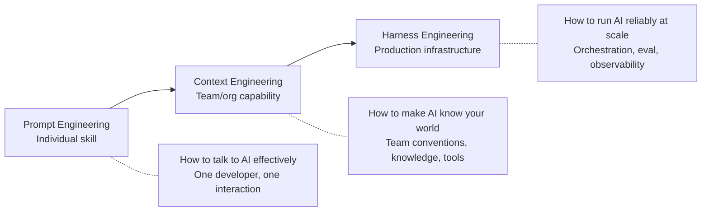

# 05 — AI Engineering Practices

> The three disciplines that make AI reliable across an engineering organization — from individual prompts to production systems.

## Why This Section Exists

AI tools are only as good as how you use them. Three distinct engineering disciplines determine whether AI is a lottery (sometimes great, sometimes garbage) or a dependable capability:

Without all three:
- **Prompt engineering alone** → individual developers get good results but the team doesn't
- **Context engineering alone** → AI knows your conventions but you can't measure or guarantee output quality
- **Harness engineering alone** → great infrastructure but AI doesn't know your domain

Together, they form a complete practice: the right information (context), delivered effectively (prompts), running reliably (harness).

## In This Section

| Page | What you'll learn |
|------|-------------------|
| **Prompt Engineering** | |
| [Prompt Engineering](./prompt-engineering.md) | Design patterns, testing, versioning — prompts as an engineering discipline |
| **Context Engineering** | |
| [What Is Context Engineering?](./what-is-context-engineering.md) | The concept, why it matters, how it differs from prompt engineering |
| [Project Instructions](./project-instructions.md) | CLAUDE.md, .cursorrules, steering files — tool-level configuration |
| [Skills and Hooks](./skills-and-hooks.md) | Reusable capabilities, event-driven automation |
| [Knowledge Architecture](./knowledge-architecture.md) | MCP servers, RAG, codebase indexing |
| [Org-Wide Strategy](./org-wide-strategy.md) | Scaling context across teams |
| **Harness Engineering** | |
| [Harness Engineering](./harness-engineering.md) | Orchestration, evaluation, guardrails, observability for AI in production |

## The Three Disciplines

### Prompt Engineering — The Individual Skill

**Who:** Every developer using AI tools.

**What:** Writing effective instructions that produce useful output. Knowing how to be specific, provide context, constrain output, and iterate.

**Maturity signal:** Developers don't just accept first output — they refine, constrain, and verify.

---

### Context Engineering — The Team/Org Capability

**Who:** Tech leads, platform teams, engineering leadership.

**What:** Structuring, maintaining, and delivering the right information to AI tools so they produce consistently useful output — independent of who's prompting.

**Maturity signal:** AI output quality doesn't depend on which developer is asking.

---

### Harness Engineering — The Production Infrastructure

**Who:** Platform teams, senior engineers building AI-powered workflows.

**What:** The orchestration layer that makes AI reliable at scale — routing, fallbacks, evaluation, guardrails, observability.

**Maturity signal:** AI workflows are monitored, tested, and recoverable — just like any production system.

---

## 💡 Key Insight

> **Prompt engineering is a personal skill. Context engineering is a team capability. Harness engineering is systems engineering.**
>
> Most organizations invest only in prompt engineering (training developers to write better prompts). The compounding value comes from context and harness — they make AI work for everyone, reliably, at scale.

---

## AI Engineering Maturity: Practices

> **Engineering Manager Note**
>
> The developer who leaves and takes all the "good prompts" with them is a single point of failure.
>
> Fix: one afternoon, one CLAUDE.md file, committed to the repo. Now the team has context, not just one person.

| Level | What it looks like | What to do |
|:-----:|-------------------|-----------|
| **0** | No project instructions, no prompt discipline, no AI infrastructure | Start with prompt training + write one CLAUDE.md |
| **1** | Developers prompt well individually; project instructions exist for main repos | Expand context to all repos, add first hook |
| **2** | Team-level steering, shared skills, hooks for quality gates | Add evaluation for critical AI workflows, prompt testing |
| **3** | Org-wide context strategy, MCP servers, AI output evaluation in CI | Build observability, guardrails, fallback patterns |
| **4** | Self-maintaining context, comprehensive harness, continuously optimized | Competitive advantage — AI is a reliable production system |

## Status

🟢 Active — content being written and refined.
