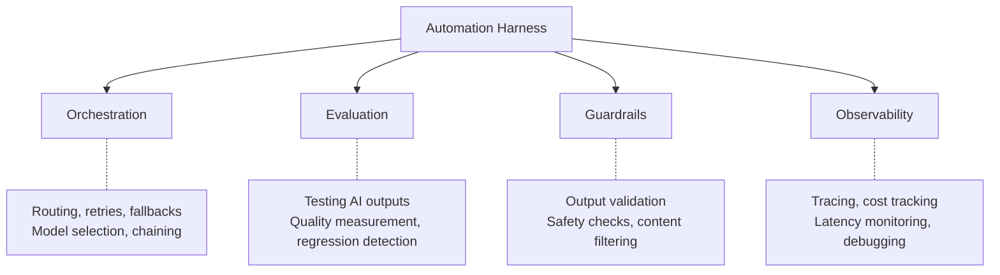
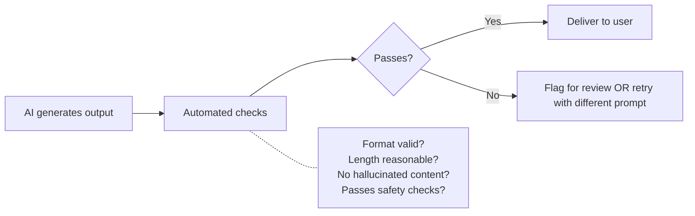
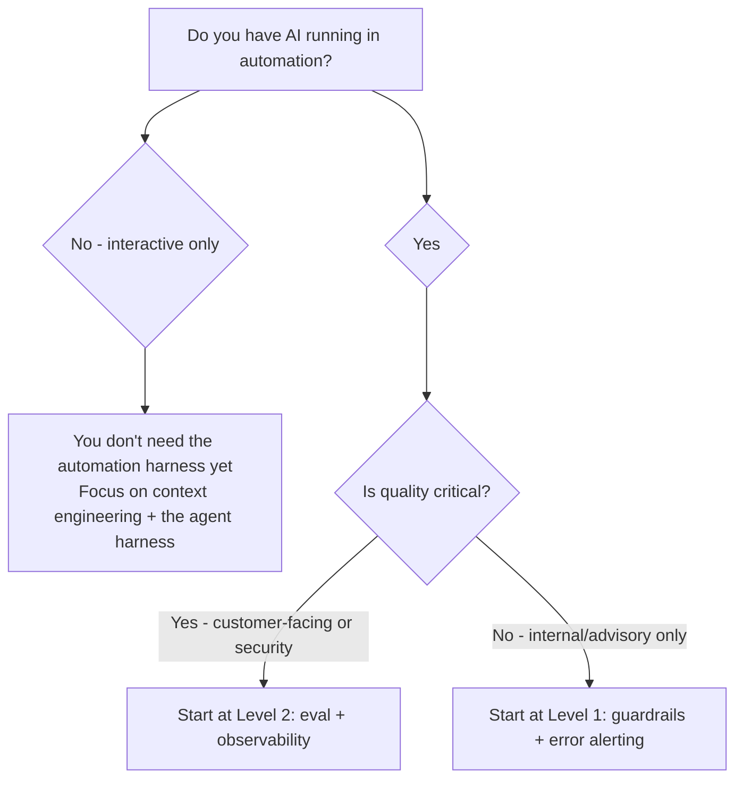

# Harness Engineering

> The environment and infrastructure that make AI reliable: the agent harness your developers' agents work inside, and the automation harness (routing, evaluation, guardrails, observability) around AI that runs unattended.

## What Harness Engineering Is

Prompt engineering tells AI what to do. Context engineering gives AI knowledge. **Harness engineering** makes the whole thing work reliably at scale — like the difference between writing code and running it in production with monitoring, fallbacks, and SLAs.

The automation harness has four pillars:



### Two meanings of "harness engineering"

You'll see this term used two ways. This page covers both, because they share the same goal: making AI output reliable without a human checking every step.

| | **Agent harness** (the common industry meaning since early 2026) | **Automation harness** (this playbook's original meaning) |
|---|---|---|
| **What it is** | The runtime and environment around a coding agent: the tool loop, context management, sandbox, and everything in the repo the agent uses to check its own work | The infrastructure around AI calls that run unattended: routing, evaluation, guardrails, observability |
| **Popularized by** | OpenAI's February 2026 post *Harness engineering: leveraging Codex in an agent-first world* | LLM-ops practice for CI bots and internal tools |
| **Who works on it** | Every team whose developers use agents | Teams running AI in CI/CD, bots, or internal tools |
| **Covered in** | [The agent harness](#the-agent-harness-making-your-repo-agent-ready) below | Pillars 1–4 below |

### The agent harness: making your repo agent-ready

In the industry sense, an agent is *a model plus a harness*. You don't build the core harness (Claude Code, Codex, Copilot, Kiro, and Cursor ship one), but you control the parts of it that live in your repository. OpenAI's write-up of building a product almost entirely with Codex attributes most of the gains to this environment, not to prompting. The levers:

| Lever | What to do | Why it matters for agents |
|-------|-----------|---------------------------|
| **Fast, deterministic feedback** | Make build, test, and lint runnable with one documented command each, and fast | Agents iterate against these signals; slow or flaky tests mean the agent can't tell if it's done |
| **Mechanical enforcement** | Encode architecture rules as linters, type checks, and structural tests rather than prose | An agent reliably obeys a failing check; it unreliably obeys a paragraph in AGENTS.md |
| **Docs as a map** | Keep `AGENTS.md` short and point it to deeper docs (`docs/ARCHITECTURE.md`, ADRs) the agent reads on demand | Long instruction files crowd out context; a map plus on-demand detail scales better |
| **Observable runtime** | Let agents run the app locally and read logs, metrics, or screenshots | Agents can verify behavior, not just compilation |
| **Sandbox and permissions** | Run agents in isolated environments with scoped credentials and limited network access | Lets you raise autonomy safely (see [Threat Model](../security/threat-model.md#prompt-injection-direct-and-indirect)) |
| **Skills and hooks** | Package recurring workflows as skills; enforce quality gates with hooks | Consistent procedures and automatic checks ([Skills and Hooks](./skills-and-hooks.md)) |
| **Garbage collection** | Periodically have agents (and humans) clean up drift, dead code, and stale docs | Agents copy whatever patterns exist, including bad ones |

> ✅ **My take:** If your developers use agents interactively, the agent harness is where your investment goes first — it's the natural next step after [project instructions](./project-instructions.md). The automation harness below matters once AI runs unattended.

---

## When You Need the Automation Harness

**You DON'T need this for:**
- Individual developers using AI tools interactively (that's prompt + context engineering, plus the [agent harness](#the-agent-harness-making-your-repo-agent-ready))
- One-off code generation in the IDE

**You DO need this for:**
- AI steps in CI/CD pipelines (PR summaries, automated review, test generation)
- Internal tools that call AI APIs (documentation generators, Slack bots, custom agents)
- Any AI workflow that runs without a human in the loop
- AI interactions where quality must be consistent and measurable

> ✅ **My take:** Most engineering teams don't need the automation harness until they have AI running in automation (CI/CD) or internal tools. If AI is only used interactively by developers, prompt and context engineering plus the agent harness are sufficient. The moment AI runs unattended — even just a PR summary bot — you need at minimum evaluation and observability.

---

## Pillar 1: Orchestration

### What It Covers

How AI calls are made, routed, retried, and composed.

### Model Selection and Routing

Not every task needs the same model. Route by task complexity:

| Task type | Model tier | Why |
|-----------|-----------|-----|
| PR summaries, commit messages | Small/fast (e.g., Anthropic's Haiku tier, OpenAI's mini/nano tiers) | Formulaic, low stakes |
| Code review comments | Mid-tier (e.g., Anthropic's Sonnet tier, OpenAI's standard tier) | Needs reasoning but not deep |
| Complex refactoring, bug investigation | Top-tier (e.g., Anthropic's Opus tier, OpenAI's flagship reasoning models) | Needs deep reasoning |
| Security analysis | Top-tier | Stakes too high for cheap models |

*Tier names are deliberately version-free. Vendors ship and retire model versions every few months, so pin exact model IDs in configuration, not in code or docs. Several tools now route between models automatically (Copilot, Cursor, Kiro); for unattended automation, prefer an explicit pinned model so a vendor routing change can't silently alter output quality.*

### Retry and Fallback Patterns

```mermaid
flowchart TD
    A[AI request] --> B{Success?}
    B -->|Yes| C[Return result]
    B -->|No - rate limited| D[Wait + retry (exponential backoff)]
    B -->|No - model down| E[Fallback to secondary model]
    B -->|No - timeout| F[Retry once, then fail gracefully]
    D --> B
    E --> B
    F --> G[Return error with context]
```

**Key principles:**
- Always have a fallback model (if primary is unavailable)
- Set timeouts (agents can loop; automation must have bounds)
- Fail gracefully (don't break the pipeline because AI is down)
- Idempotency (retries shouldn't cause duplicate actions)

### Chaining (Multi-Step Workflows)

For complex automation, compose multiple AI calls:

```
Step 1: Summarize the PR diff (cheap model, fast)
Step 2: IF summary mentions security-relevant files:
          Run security review (expensive model, thorough)
Step 3: Post combined results as PR comment
```

**Key principle:** Use the cheapest model that works for each step. Only escalate to expensive models when the task demands it.

---

## Pillar 2: Evaluation

### What It Covers

How you know AI output is good enough — systematically, not anecdotally.

### Evaluation Approaches

| Approach | How it works | Best for |
|----------|-------------|----------|
| **Deterministic checks** | Regex, schema validation, format verification | Structured output (JSON, specific formats) |
| **Golden dataset comparison** | Run against known inputs, compare to expected outputs | Regression testing after model/prompt changes |
| **LLM-as-judge** | Use a second AI call to evaluate the first one's output | Complex quality assessment at scale |
| **Human spot-check** | Sample N outputs/week, human rates quality | Ongoing quality monitoring |
| **Downstream metrics** | Track if AI-generated PRs get merged, reviewed, reverted | Real-world impact measurement |

### Building an Eval Pipeline



### When to Invest in Evaluation

| Signal | What it means | Action |
|--------|---------------|--------|
| AI output used in automation without human review | Quality not guaranteed | Add automated eval checks |
| Developers complain output quality varies | Model or prompt drift | Add regression testing |
| AI output affects customers (docs, responses) | Quality = brand risk | Add LLM-as-judge + human spot-check |
| You changed models or prompts | May have regressed | Run golden dataset comparison |

---

## Pillar 3: Guardrails

### What They Cover

Preventing AI from producing harmful, incorrect, or policy-violating output.

### Types of Guardrails

| Guardrail | What it catches | Implementation |
|-----------|----------------|---------------|
| **Output validation** | Malformed output, wrong format | Schema validation, regex checks |
| **Content filtering** | Inappropriate content, PII in output | Pattern matching, classification |
| **Scope enforcement** | AI suggesting changes outside allowed boundaries | Path/file allowlists |
| **Cost caps** | Runaway token usage | Per-request and per-session limits |
| **Rate limiting** | Abuse or stuck loops | Request caps per time window |
| **Confidentiality** | Secrets or internal data leaking into output | Output scanning for patterns |

### Guardrails for CI/CD AI Steps

```yaml
# Conceptual guardrails for a PR summary bot
guardrails:
  max_tokens: 2000          # Don't generate a novel
  max_cost_per_run: $0.50   # Kill if too expensive
  timeout: 30s              # Don't hang the pipeline
  output_checks:
    - must_be_markdown       # Format validation
    - max_length: 500_words  # Reasonable summary length
    - no_secrets_pattern     # Don't echo secrets from diff
  fallback: skip_gracefully  # If AI fails, PR continues without summary
```

---

## Pillar 4: Observability

### What It Covers

Seeing what AI is doing — performance, cost, quality, failures.

### What to Observe

| Metric | Why | How |
|--------|-----|-----|
| **Latency** | AI calls that slow pipelines need optimization | Trace duration per AI step |
| **Cost per call** | Budget management, anomaly detection | Log tokens in/out per request |
| **Error rate** | Reliability of AI steps | Track failures, retries, fallbacks |
| **Output quality** | Detect drift or degradation | Eval scores over time |
| **Token usage** | Cost trending, efficiency | Daily/weekly aggregation |

### Tracing AI Calls

For any AI in automation, add tracing:

```
[2026-10-15T14:23:01] PR #482 summary
  Model: <small-tier model ID, from config>
  Input tokens: 1,247
  Output tokens: 312
  Latency: 1.2s
  Cost: $0.004
  Status: success
  Eval: format_valid=true, length_ok=true
```

### Dashboard for AI Infrastructure

```
AI Automation Health — Weekly

Pipelines using AI: 4 (PR summary, coverage suggest, doc check, security review)
Total AI calls this week: 847
Success rate: 99.2% (7 failures — all retried successfully)
Total cost: $42.31 ($5.89/day average)
Avg latency: 1.8s (P99: 4.2s)
Quality (spot-check): 4.2/5 (sampled 20 outputs)
```

---

## Automation Harness Maturity

| Level | What it looks like |
|:-----:|-------------------|
| **0** | AI in automation with no guardrails, no monitoring, no evaluation |
| **1** | Basic guardrails (timeout, cost cap) + error alerting |
| **2** | Evaluation checks on output + observability dashboard |
| **3** | Full tracing, quality regression testing, model routing, fallbacks |
| **4** | Self-optimizing: automatic model selection based on task, cost-quality tradeoffs automated |

---

## When to Start



> ✅ **My take:** Don't over-invest in the automation harness before you need it. If AI is only interactive (developers in IDE), context engineering and the agent harness are your priority. The moment you have a single AI step in CI or an internal bot calling an API, add basic guardrails (Level 1). Only build full observability when you have 3+ AI automation workflows — before that, logs are sufficient.

---

## Next

- Prompting foundations → [Prompt Engineering](./prompt-engineering.md)
- Context that feeds the harness → [Knowledge Architecture](./knowledge-architecture.md)
- CI/CD integration patterns → [Engineering Workflows: CI/CD](../engineering-workflows/cicd-integration.md)
