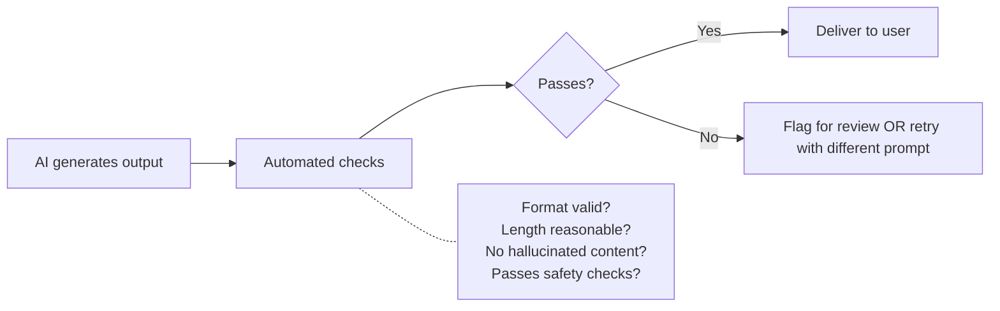

# Harness Engineering

> The orchestration layer that makes AI reliable in production — routing, evaluation, guardrails, and observability.

## What Harness Engineering Is

Prompt engineering tells AI what to do. Context engineering gives AI knowledge. **Harness engineering** makes the whole thing work reliably at scale — like the difference between writing code and running it in production with monitoring, fallbacks, and SLAs.


---

## When You Need Harness Engineering

**You DON'T need this for:**
- Individual developers using AI tools interactively (that's prompt + context engineering)
- One-off code generation in the IDE

**You DO need this for:**
- AI steps in CI/CD pipelines (PR summaries, automated review, test generation)
- Internal tools that call AI APIs (documentation generators, Slack bots, custom agents)
- Any AI workflow that runs without a human in the loop
- AI interactions where quality must be consistent and measurable

> ✅ **Our take:** Most engineering teams don't need harness engineering until they have AI running in automation (CI/CD) or internal tools. If AI is only used interactively by developers, prompt + context engineering is sufficient. The moment AI runs unattended — even just a PR summary bot — you need at minimum evaluation and observability.

---

## Pillar 1: Orchestration

### What It Covers

How AI calls are made, routed, retried, and composed.

### Model Selection and Routing

Not every task needs the same model. Route by task complexity:

| Task type | Model tier | Why |
|-----------|-----------|-----|
| PR summaries, commit messages | Cheap/fast (Haiku, GPT-4o-mini) | Formulaic, low stakes |
| Code review comments | Mid-tier (Sonnet, GPT-4o) | Needs reasoning but not deep |
| Complex refactoring, bug investigation | Top-tier (Opus, GPT-4) | Needs deep reasoning |
| Security analysis | Top-tier | Stakes too high for cheap models |

### Retry and Fallback Patterns

```mermaid
flowchart TD
    A[AI request] --> B{Success?}
    B -->|Yes| C[Return result]
    B -->|No - rate limited| D[Wait + retry (exponential backoff)]
    B -->|No - model down| E[Fallback to secondary model]
    B -->|No - timeout| F[Retry once, then fail gracefully]
    D --> B
    E --> B
    F --> G[Return error with context]
```

**Key principles:**
- Always have a fallback model (if primary is unavailable)
- Set timeouts (agents can loop; automation must have bounds)
- Fail gracefully (don't break the pipeline because AI is down)
- Idempotency (retries shouldn't cause duplicate actions)

### Chaining (Multi-Step Workflows)

For complex automation, compose multiple AI calls:

```
Step 1: Summarize the PR diff (cheap model, fast)
Step 2: IF summary mentions security-relevant files:
          Run security review (expensive model, thorough)
Step 3: Post combined results as PR comment
```

**Key principle:** Use the cheapest model that works for each step. Only escalate to expensive models when the task demands it.

---

## Pillar 2: Evaluation

### What It Covers

How you know AI output is good enough — systematically, not anecdotally.

### Evaluation Approaches

| Approach | How it works | Best for |
|----------|-------------|----------|
| **Deterministic checks** | Regex, schema validation, format verification | Structured output (JSON, specific formats) |
| **Golden dataset comparison** | Run against known inputs, compare to expected outputs | Regression testing after model/prompt changes |
| **LLM-as-judge** | Use a second AI call to evaluate the first one's output | Complex quality assessment at scale |
| **Human spot-check** | Sample N outputs/week, human rates quality | Ongoing quality monitoring |
| **Downstream metrics** | Track if AI-generated PRs get merged, reviewed, reverted | Real-world impact measurement |

### Building an Eval Pipeline



### When to Invest in Evaluation

| Signal | What it means | Action |
|--------|---------------|--------|
| AI output used in automation without human review | Quality not guaranteed | Add automated eval checks |
| Developers complain output quality varies | Model or prompt drift | Add regression testing |
| AI output affects customers (docs, responses) | Quality = brand risk | Add LLM-as-judge + human spot-check |
| You changed models or prompts | May have regressed | Run golden dataset comparison |

---

## Pillar 3: Guardrails

### What They Cover

Preventing AI from producing harmful, incorrect, or policy-violating output.

### Types of Guardrails

| Guardrail | What it catches | Implementation |
|-----------|----------------|---------------|
| **Output validation** | Malformed output, wrong format | Schema validation, regex checks |
| **Content filtering** | Inappropriate content, PII in output | Pattern matching, classification |
| **Scope enforcement** | AI suggesting changes outside allowed boundaries | Path/file allowlists |
| **Cost caps** | Runaway token usage | Per-request and per-session limits |
| **Rate limiting** | Abuse or stuck loops | Request caps per time window |
| **Confidentiality** | Secrets or internal data leaking into output | Output scanning for patterns |

### Guardrails for CI/CD AI Steps

```yaml
# Conceptual guardrails for a PR summary bot
guardrails:
  max_tokens: 2000          # Don't generate a novel
  max_cost_per_run: $0.50   # Kill if too expensive
  timeout: 30s              # Don't hang the pipeline
  output_checks:
    - must_be_markdown       # Format validation
    - max_length: 500_words  # Reasonable summary length
    - no_secrets_pattern     # Don't echo secrets from diff
  fallback: skip_gracefully  # If AI fails, PR continues without summary
```

---

## Pillar 4: Observability

### What It Covers

Seeing what AI is doing — performance, cost, quality, failures.

### What to Observe

| Metric | Why | How |
|--------|-----|-----|
| **Latency** | AI calls that slow pipelines need optimization | Trace duration per AI step |
| **Cost per call** | Budget management, anomaly detection | Log tokens in/out per request |
| **Error rate** | Reliability of AI steps | Track failures, retries, fallbacks |
| **Output quality** | Detect drift or degradation | Eval scores over time |
| **Token usage** | Cost trending, efficiency | Daily/weekly aggregation |

### Tracing AI Calls

For any AI in automation, add tracing:

```
[2025-06-15T14:23:01] PR #482 summary
  Model: claude-3-5-haiku
  Input tokens: 1,247
  Output tokens: 312
  Latency: 1.2s
  Cost: $0.004
  Status: success
  Eval: format_valid=true, length_ok=true
```

### Dashboard for AI Infrastructure

```
AI Automation Health — Weekly

Pipelines using AI: 4 (PR summary, coverage suggest, doc check, security review)
Total AI calls this week: 847
Success rate: 99.2% (7 failures — all retried successfully)
Total cost: $42.31 ($5.89/day average)
Avg latency: 1.8s (P99: 4.2s)
Quality (spot-check): 4.2/5 (sampled 20 outputs)
```

---

## Harness Maturity

| Level | What it looks like |
|:-----:|-------------------|
| **0** | AI in automation with no guardrails, no monitoring, no evaluation |
| **1** | Basic guardrails (timeout, cost cap) + error alerting |
| **2** | Evaluation checks on output + observability dashboard |
| **3** | Full tracing, quality regression testing, model routing, fallbacks |
| **4** | Self-optimizing: automatic model selection based on task, cost-quality tradeoffs automated |

---

## When to Start


> ✅ **Our take:** Don't over-invest in harness engineering before you need it. If AI is only interactive (developers in IDE), context engineering is your priority. The moment you have a single AI step in CI or an internal bot calling an API, add basic guardrails (Level 1). Only build full observability when you have 3+ AI automation workflows — before that, logs are sufficient.

---

## Next

- Prompting foundations → [Prompt Engineering](./prompt-engineering.md)
- Context that feeds the harness → [Knowledge Architecture](./knowledge-architecture.md)
- CI/CD integration patterns → [Engineering Workflows: CI/CD](../engineering-workflows/cicd-integration.md)
