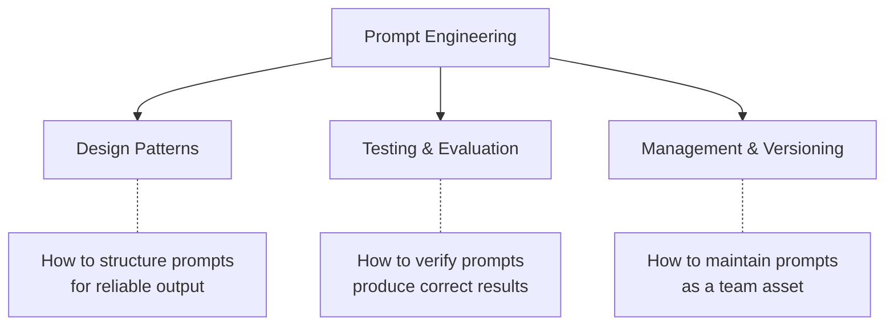
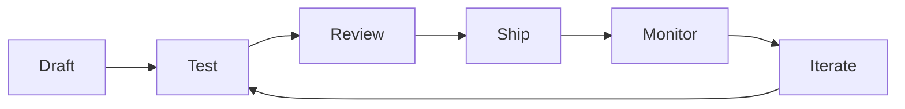

# Prompt Engineering

> Designing, testing, and managing prompts as an engineering discipline — not just a personal skill.

## Beyond "Write Better Prompts"

Most prompt engineering advice stops at "be specific." That's the starting point, not the destination. For engineering organizations, prompts are **artifacts that affect production quality** — they deserve the same discipline as code.



---

## Prompt Design Patterns

### Pattern 1: System Prompt + Task Prompt (Separation of Concerns)

**What:** Separate persistent instructions (system prompt / project instructions) from per-task instructions.

**Why:** System prompts set conventions once. Task prompts focus on the specific goal. This mirrors context engineering (durable) vs. individual prompting (ephemeral).

```
SYSTEM (in CLAUDE.md / .cursorrules):
  "You are working on a TypeScript API. Use async/await.
   Follow repository pattern. Tests use Jest."

TASK (developer's prompt):
  "Add pagination to the /users endpoint. Include input validation
   and tests for boundary cases."
```

**The system prompt handles "how we work here." The task prompt handles "what I need now."**

---

### Pattern 2: Constraint-First Prompting

**What:** Lead with constraints and exclusions before describing what you want.

**Why:** AI tools tend to over-generate. Constraints prevent common failure modes (over-engineering, scope creep, wrong patterns).

```
DON'T:
  "Add error handling to this file"

DO:
  "Add error handling to this file.
   Constraints:
   - Use our AppError class (not generic Error)
   - Don't add try/catch to functions that already have it
   - Don't change the public interface
   - Don't add error handling for impossible cases"
```

---

### Pattern 3: Chain-of-Thought (for Complex Tasks)

**What:** Ask the AI to reason through steps before acting.

**Why:** For complex tasks, reasoning first produces better output than jumping straight to code. Prevents "plausible but wrong" solutions.

```
"Before implementing, think through:
1. What are the edge cases for this function?
2. What could fail at runtime?
3. What's the simplest approach that handles all cases?

Then implement based on your analysis."
```

**Best for:** Bug investigation, architecture suggestions, complex refactoring decisions.

---

### Pattern 4: Few-Shot (Showing Examples)

**What:** Provide 1–3 examples of desired output format before asking for the real one.

**Why:** Showing is more precise than telling. Examples eliminate ambiguity about format, style, and depth.

```
"Generate a test for the deleteUser function.
Follow this exact pattern:

describe('deleteUser', () => {
  it('should soft-delete the user and return 204', async () => {
    const user = await createTestUser();
    const response = await request(app).delete(`/users/${user.id}`);
    expect(response.status).toBe(204);
    expect(await User.findById(user.id)).toHaveProperty('deletedAt');
  });
});

Now write tests for the updateUser function following the same pattern."
```

---

### Pattern 5: Role + Task + Format (Structured Prompting)

**What:** Explicitly state the role, the task, and the desired output format.

**Why:** Removes ambiguity. AI knows what perspective to take, what to do, and how to present it.

```
ROLE: You are a senior backend engineer reviewing a pull request.
TASK: Review this diff for security issues, performance problems, and logic errors.
FORMAT: For each issue found, provide:
  - Severity (Critical/High/Medium/Low)
  - File and line
  - What's wrong (one sentence)
  - How to fix (code example)
```

---

## Testing Prompts

### Why Test Prompts?

Prompts are code. Untested code breaks. Untested prompts produce inconsistent results. For any prompt that's:
- Used repeatedly (shared in your prompts library)
- Used in automation (CI/CD pipeline, hooks)
- Critical to output quality (security review prompts, code generation templates)

...you should test it.

### How to Test Prompts

| Method | How | When to use |
|--------|-----|-------------|
| **Golden output comparison** | Run prompt against known input, compare to expected output | Prompts in CI (deterministic tasks) |
| **Rubric scoring** | Define 5 criteria, score output 1–5 on each | Evaluating prompt quality changes |
| **A/B comparison** | Run old and new prompt on same inputs, compare | Before updating a shared prompt |
| **Regression check** | Re-run prompt after model/tool update, verify output quality holds | After tool updates |
| **Adversarial testing** | Give prompt edge cases and malicious inputs | Security-relevant prompts |

### Practical Example: Testing a Code Review Prompt

```
INPUT: Known code with 3 planted bugs (one critical, two medium)

TEST:
  - Does the prompt find the critical bug? (must pass)
  - Does it find at least 1 medium bug? (should pass)
  - Does it produce zero false positives? (nice to have)
  - Is output format consistent? (must pass)

RUN: Execute prompt against input with 3 different models.
PASS: All "must pass" criteria met on all models.
```

---

## Managing Prompts as Assets

### The Prompt Lifecycle



### Versioning

Prompts should be version-controlled (in your repo) when they:
- Are shared across the team (prompt library)
- Are used in automation (CI/CD, hooks)
- Produce output that affects production (code generation templates)

```
prompts/
├── code-review/
│   ├── security-review.md      # v3 — updated for new auth patterns
│   └── CHANGELOG.md            # What changed and why
├── testing/
│   ├── unit-test-generation.md # v2 — added edge case requirement
│   └── CHANGELOG.md
```

### When to Update a Shared Prompt

| Trigger | Action |
|---------|--------|
| AI consistently gets something wrong | Add constraint to prevent the error |
| Team conventions change | Update prompt to reflect new patterns |
| New model released | Test existing prompts on new model, adjust if needed |
| New anti-pattern discovered | Add to "don't" list |
| Prompt produces inconsistent format | Add explicit format specification |

---

## The Progression: Personal Skill → Team Asset

| Level | What it looks like |
|:-----:|-------------------|
| **Individual skill** | Each developer writes their own prompts. Quality varies. Knowledge is in heads. |
| **Shared patterns** | Team has a prompts library. Common tasks have tested templates. New hires start productive. |
| **Engineered discipline** | Prompts are versioned, tested, reviewed. Changes go through PRs. Regressions caught. |

> ✅ **Our take:** Most teams should aim for "Shared patterns" (a prompts library with documented patterns). Only invest in full "Engineered discipline" for prompts used in automation or CI — those need testing because they run unattended. For daily interactive use, shared patterns are sufficient.

---

## Next

- How context engineering builds on prompts → [What Is Context Engineering?](./what-is-context-engineering.md)
- Reusable prompt examples → [Prompts Library](../prompts/)
- How harness engineering runs prompts reliably → [Harness Engineering](./harness-engineering.md)
