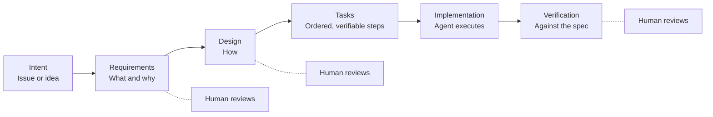

# Spec-Driven Development

> Writing down what to build — requirements, design, and a task plan — as a reviewed artifact *before* an agent writes code. A practice that works across tools, not a feature of one.

## What It Is

In spec-driven development (SDD), a written specification is the primary artifact of AI-assisted work. The agent helps write it, a human reviews and approves it, and then the agent implements against it. The spec is versioned in the repository alongside the code.

It's a response to a specific failure: agents are fast at producing *something*, so the expensive mistakes shift from "wrote it badly" to "built the wrong thing." Reviewing a two-page spec is much cheaper than reviewing a 2,000-line PR that solves the wrong problem.

---

## A Spectrum, Not a Switch

Teams use specs with very different levels of rigor:

| Level | What it looks like | Good for |
|-------|-------------------|---------|
| **Plan mode** | The agent proposes a plan in the session; the developer approves or edits it before any code changes | Most interactive work; nearly free |
| **Spec-first** | Requirements, design, and tasks written and reviewed as files before implementation; may be discarded after | Features of a few days' work; delegated agent tasks |
| **Spec-anchored** | The spec stays in the repo and is updated when behavior changes; it's the reference for future changes | Long-lived features, regulated domains, multi-team work |
| **Spec-as-source** | The spec is the thing humans maintain; code is regenerated from it | Experimental; not yet a mainstream practice |

> ✅ **My take:** Use plan mode by default, spec-first for anything you'd delegate or anything over a day of work, and spec-anchored only where an audit trail or long-term reference earns its upkeep. Spec-as-source is worth watching, not betting on.

---

## Tools

The practice is portable. These tools support it directly:

| Tool | How it supports SDD |
|------|--------------------|
| **Kiro** | Spec sessions produce `requirements.md`, `design.md`, and `tasks.md` under `.kiro/specs/<feature>/`, then execute tasks one at a time; hooks can run on task start and completion |
| **GitHub Spec Kit** | Open-source toolkit that adds spec-driven commands (constitution, specify, plan, tasks, implement) to many agents, including Copilot, Claude Code, Codex, Cursor, and Gemini CLI (check the [Spec Kit repo](https://github.com/github/spec-kit) for the current list) |
| **Plan modes** | Claude Code, Cursor, Copilot (VS Code), and others offer a read-only planning mode that produces a plan for approval before edits |
| **Your issue tracker** | For delegated agents, a well-written issue *is* a lightweight spec — see [Delegated Agents](../ai-coding-agents/delegated-agents.md#when-to-delegate) |

---

## What a Good Spec Contains

Keep it short enough that someone will actually review it.

**Requirements**
- The problem and who has it
- Acceptance criteria written so they can be tested (for example, "When a user submits an expired token, the API returns 401 and logs the attempt")
- Explicit non-goals: what this change will *not* do

**Design**
- The approach, and the alternative you rejected and why
- Interfaces and data changes
- Security, performance, and migration considerations
- Which existing patterns or files to follow

**Tasks**
- Ordered steps, each small enough to review and verify on its own
- How each step is verified (which tests, which command)

---

## When It Pays Off, and When It Doesn't

| Worth it | Not worth it |
|----------|-------------|
| Delegated or long-running agent work | One-line fixes and small refactors |
| Features with real ambiguity or several stakeholders | Spikes and prototypes you'll throw away |
| Changes touching security, data, or public APIs | Work where you're still figuring out what you want |
| Regulated work that needs an audit trail | Changes fully defined by a failing test |

### Pitfalls

- **Spec drift.** The code changes and the spec doesn't. Either update specs as part of the PR, or label them as point-in-time and stop treating them as reference.
- **Big design up front.** A 20-page spec reintroduces the waterfall problems agile fixed. Keep specs to what's needed to start, and revise them as you learn.
- **Rubber-stamped specs.** If nobody reads the spec carefully, you've added a step without adding a check. The spec review is where the human judgment goes.
- **Over-specifying the how.** Detailed implementation instructions make the agent follow your plan even when the codebase suggests a better one. Specify outcomes and constraints; leave room on the details.

---

## Getting Started

1. **This week:** Turn on plan mode as the team default for any task larger than a quick fix. Approve plans before edits.
2. **Next sprint:** Pick one feature. Have the agent draft requirements, design, and tasks as Markdown in the repo; review them in a PR before implementation starts.
3. **After that:** Add a spec template to your repo, and make "spec approved" a prerequisite for delegating a feature to a cloud agent.

---

## Next

- Turning specs into delegated work → [Delegated and Parallel Agents](../ai-coding-agents/delegated-agents.md)
- Encoding repeatable procedures → [Skills and Hooks](./skills-and-hooks.md)
- Keeping agents focused on the right context → [What Is Context Engineering?](./what-is-context-engineering.md#managing-the-context-window)
