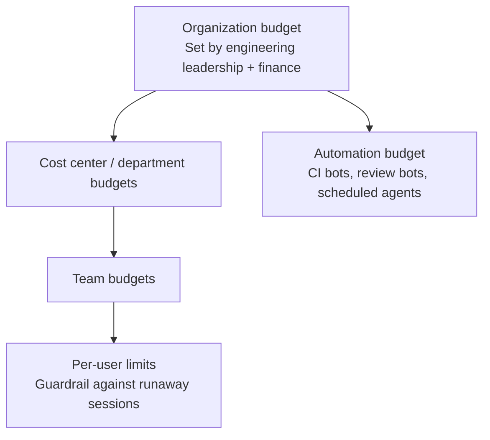

# AI Spend Management

> Running AI tool spend like cloud spend: budget hierarchies, caps, unit economics, and a monthly review — now that almost every vendor bills by usage.

> **Last verified:** 2026-10-30 · **Re-check by:** 2027-01-30

## Why This Needs Its Own Practice

Through 2024, AI coding tools were a seat line item: count developers, multiply by $19 or $39, done. That model is gone. In 2026 the major vendors moved to seats with included usage plus metered overage (see [Agent Landscape](../ai-coding-agents/agent-landscape.md) for current terms):

- **GitHub Copilot** replaced premium requests with GitHub AI Credits on June 1, 2026, consumed at each model's token rates, with credits pooled across the organization
- **Kiro** sells credit tiers with opt-in overage
- **Cursor** moved to "The X Subscription" in October 2026, with third-party models billed at API list price on every tier
- **Claude** Team and Enterprise mix seats with usage; Enterprise bills all usage at API rates
- **Codex** added pay-as-you-go usage for ChatGPT Business teams

Agent sessions cost far more to serve than autocomplete, and usage per developer keeps rising as agents get more capable and developers run several in parallel. The seat price tells you the floor. It doesn't tell you the bill.

> ✅ **My take:** Treat AI spend like cloud spend, not like software licenses. That means an owner, budgets at several levels, unit metrics, and a monthly review. The organizations that get surprised are the ones still managing it as a license count.

---

## 1. Set a Budget Hierarchy

Most vendors now let admins set budgets at several levels. Use all of them.



| Level | Who owns it | Typical setting |
|-------|------------|-----------------|
| **Organization** | VP Engineering + finance | Annual plan, reviewed quarterly |
| **Cost center / team** | Engineering managers | Monthly; sized from the team's last 2–3 months of usage |
| **Per user** | Platform team sets defaults | A ceiling that catches stuck loops, not a target to hit |
| **Automation** | Owners of each pipeline | Separate line; unattended agents shouldn't eat interactive budget |

Starting per-user ranges are in [Governing Agents](../ai-coding-agents/governing-agents.md#setting-usage-budgets).

## 2. Decide: Cap or Overage?

When a pool runs out, you choose between blocking further usage and paying for more. Make this decision deliberately, per level:

| Choice | Use when | Risk |
|--------|---------|------|
| **Hard cap** | Per-user limits; automation budgets; early pilots | Developers blocked mid-task; work moves to personal accounts (shadow IT) |
| **Overage allowed, with alerts** | Team and org budgets once you have baseline data | Surprise bills if nobody watches the alerts |
| **Overage with approval** | Heavy users and large migrations | Approval friction; keep the process fast |

> ✅ **My take:** Hard-cap individuals and automation; allow overage with alerts at team level. A blocked developer costs more in lost time than most overage bills. A blocked runaway bot costs nothing.

## 3. Track Unit Economics

Total spend says nothing about value. Track these:

| Metric | How to compute | What it tells you |
|--------|---------------|-------------------|
| **Cost per active developer per month** | Total spend ÷ developers with usage that month | Trend and outliers; compare to vendor tier prices |
| **Cost per merged PR** (AI-assisted) | AI spend ÷ merged PRs that used AI | The core unit cost; should be stable or falling |
| **Cost per delegated task** | Cloud agent spend ÷ agent tasks started | Includes abandoned tasks, which are pure cost |
| **Agent PR acceptance rate** | Merged agent PRs ÷ opened agent PRs | Low rates mean spend on work nobody uses |
| **Automation cost per run** | Pipeline AI spend ÷ runs | Catches bots that drift into expensive models |
| **Inactive seats** | Seats with zero usage in 30 days | The old seat-waste problem still exists |

Remember the cost you won't see on an AI invoice: **reviewer time**. Telemetry studies show review time rising sharply as AI output rises (see [What the Research Says](../productivity/what-the-research-says.md)). A cheap agent PR that takes an hour to review isn't cheap.

## 4. Understand Model Routing

Several tools now pick the model for you: Copilot (Fusion and auto selection), Cursor (Auto), Kiro (Auto). Routing changes both cost and quality:

- **Interactive use:** Auto routing usually lowers cost per task. Let it run, and watch quality signals (rejection rate, rework).
- **Automation:** Pin an explicit model. A vendor routing change shouldn't silently change the cost or output of a CI job. See [Harness Engineering](../ai-engineering-practices/harness-engineering.md).
- **Premium models:** If developers can manually select the most expensive models, decide whether that's allowed for everyone or by request.
- **Third-party models:** Some tools bill non-native models separately at list price. Check which models are "included" before letting teams choose freely.

## 5. Run a Monthly Review

A 30-minute monthly review with the platform team, a finance partner, and one or two engineering managers:

```
AI Spend Review — October

Total:            $48,200   (budget $50,000, ▲ 12% vs. September)
Active devs:      310       → $155 per active developer
Merged AI PRs:    4,120     → $11.70 per merged PR (▼ from $12.40)
Delegated tasks:  1,050     → acceptance rate 71%
Automation:       $3,900    (PR review bot, nightly test-gap agent)

Top movers:
  - Payments team ▲ 40%: migration project, pre-approved
  - Nightly test-gap agent ▲ 3×: routed to a premium model after vendor change → pinned model
Inactive seats:   22 → reclaimed
Actions:          raise Platform team budget 15% for Q4 migration; review agent PR acceptance on Team X (48%)
```

**Anomaly signals worth an alert:**
- A user or bot at >3× their trailing average for a day
- Automation spend rising while run count is flat (model or prompt drift)
- Cost per merged PR rising for two months straight
- Agent acceptance rate falling below ~50% for a team

## 6. Assign an Owner

Someone has to own AI spend end to end. In most organizations that's the platform or developer-experience team, partnered with finance (see [Operating Model](./operating-model.md)). Their job: maintain budgets and caps, run the monthly review, negotiate vendor terms, and publish unit metrics to engineering leadership.

---

## Contract Terms That Matter Under Usage Billing

Add these to the negotiation list in [Vendor Strategy](./vendor-strategy.md):

- Per-unit usage rates fixed for the contract term
- Org-wide pooling of included usage (no stranded per-seat credits)
- Admin-enforced hard caps at org, cost-center, and user level
- Usage export via API, at per-user and per-repo granularity
- Notice period before changes to model multipliers or included credits

---

## Next

- Per-developer budget ranges → [Governing Agents](../ai-coding-agents/governing-agents.md#setting-usage-budgets)
- Pulling usage data from vendor APIs → [Cost Tracking Examples](../examples/cost-tracking/)
- How much to invest overall → [Investment Strategy](./investment-strategy.md)
