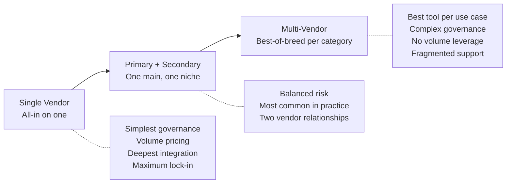

# Vendor Strategy

> Single-vendor vs. multi-vendor, lock-in mitigation, contract management, and exit planning.

> **Last verified:** 2026-10-30 · **Re-check by:** 2027-01-30

## Why Vendor Strategy Matters

AI tools are sticky. Once 200 developers build muscle memory with a tool, switching is expensive — not just in license cost but in lost productivity during transition, retraining, and context rebuilding. Make intentional choices upfront.

---

## The Spectrum

> ✅ **My take:** **Primary + Secondary** is the right model for most orgs. Pick one platform tool as your primary — handles 80% of daily use — chosen against your own criteria (existing ecosystem fit, enterprise controls, per-seat cost at your scale, developer preference from a trial). Copilot, Kiro, and Cursor are common primary choices today because of ecosystem fit (GitHub, AWS, and IDE-native respectively) — that's not an endorsement of these three over comparable options like Claude Code, Codex, Devin Desktop, Tabnine, or Google Antigravity; run your own shortlist through the [Evaluation Framework](../ai-tools/evaluation-framework.md) rather than picking from this list by name. Keep one secondary option available (typically CLI-based like Claude Code, Codex, or Aider) for power users and specific use cases the primary doesn't cover well. This gives you flexibility without governance chaos.

---

## Open Standards Lower Switching Costs

The strongest lock-in reducer in 2026 isn't a contract clause; it's the set of open standards most coding agents now share. The Linux Foundation's **Agentic AI Foundation (AAIF)**, founded by Anthropic, OpenAI, and Block with AWS, Google, Microsoft, and others as members, now stewards the main ones:

| Standard | What it makes portable | Adoption (Oct 2026) |
|----------|----------------------|---------------------|
| **AGENTS.md** | Project instructions and conventions | Read natively by Codex, Copilot, Cursor, Kiro, Devin, Cline, and others; Claude Code imports it from CLAUDE.md |
| **Agent Skills (SKILL.md)** | Reusable task procedures, with scripts and templates | Supported by Claude Code, Copilot, Codex, Cursor, Kiro, Cline, Antigravity, and others; donated to AAIF October 22, 2026 |
| **MCP (Model Context Protocol)** | Connections to internal systems, data, and tools | Supported by essentially every major agent |
| **A2A (Agent2Agent)** | Communication between agents from different vendors | v1.0 since March 2026; joined AAIF in 2026; most relevant if you build your own agents |

**What's still proprietary** (budget for rework if you switch):
- Hook formats and event names (similar concepts, different files: [Skills and Hooks](../ai-engineering-practices/skills-and-hooks.md))
- Permission and managed-settings formats
- Cloud agent configuration and environment setup
- Agent memory, which usually can't be exported
- Spec formats (Kiro specs vs. other spec tools)
- Usage history and analytics

> ✅ **My take:** Make "uses the open standard" a scoring criterion in every tool evaluation. Store instructions in `AGENTS.md`, procedures as Agent Skills in your repo, and integrations as MCP servers. If you do, switching your primary tool costs days of reconfiguration rather than months of rebuilding context.

---

## Lock-In Risks by Category

| Lock-in type | What traps you | Mitigation |
|-------------|---------------|-----------|
| **Data lock-in** | Custom fine-tuning, proprietary model on your data | Ensure you can export/delete data; avoid fine-tuning unless critical |
| **Workflow lock-in** | Tool-specific automation, hooks, integrations | Use standards where possible (MCP and Agent Skills vs. proprietary plugins) |
| **Skill lock-in** | Team builds muscle memory with one tool | Most skills transfer (prompting is similar across tools) |
| **Context lock-in** | Project instructions in tool-specific format | Keep instructions in `AGENTS.md`; tool-specific files are thin overlays |
| **Ownership-change risk** | Vendor is acquired and terms, pricing, or product direction change (Windsurf → Cognition in 2025–26; Cursor → SpaceX in 2026) | Change-of-control clause in contracts; keep context in open standards so you can leave |
| **Contract lock-in** (🏢) | Multi-year agreements with penalties | Start with annual; only commit multi-year after 12+ months of proven value |
| **Ecosystem lock-in** | Tool tightly coupled to platform (Copilot ↔ GitHub) | Acceptable if you're committed to the platform; risky if you might migrate |

---

## Contract Negotiation Principles

| Principle | Why | What to negotiate |
|-----------|-----|-------------------|
| **Annual, not multi-year** (initially) | You've used this tool for 6 months. Don't lock in for 3 years. | 1-year initial term with renewal option |
| **Volume discount without lock-in** | Get pricing benefit without commitment trap | Discount based on current seats, not future commitment |
| **Exit clause** | What happens if you need to leave? | Data export within 30 days, no penalty for non-renewal |
| **Change of control** | Two major AI coding tools changed owner in 2025–26, and one changed its contracting entity mid-contract | Right to terminate or renegotiate if the vendor is acquired or the contracting entity changes |
| **Usage pricing terms** | Seats now include metered usage; rates and included credits can change | Fixed per-unit usage rates for the term, pooled credits, and hard spend caps |
| **No training on code** | Non-negotiable | Written in DPA, not just marketing claims |
| **Price protection** | Vendors raise prices | Cap annual increase (max 5–10%) or price lock for term |
| **Usage flexibility** | Team composition changes | Ability to reassign seats, not just add |

---

## Exit Planning

Even if you're happy with your vendor today, plan for the possibility of leaving:

### Keep Portable

| Asset | Keep portable | How |
|-------|:------------:|-----|
| Project instructions | ✅ | Keep shared conventions in `AGENTS.md`, which most agents read natively. Tool-specific files (CLAUDE.md, Cursor rules, Kiro steering) become thin overlays. |
| Prompts library | ✅ | Store in repo as Markdown, not in tool-specific format |
| Skills | ✅ | Write them as Agent Skills (`SKILL.md` folders) in the repo; most agents load them unchanged |
| Hooks | ⚠️ | Concepts transfer; config formats and event names are tool-specific. Keep the hook *logic* in scripts the config calls, so only the thin config needs rewriting |
| MCP servers | ✅ | MCP is an open standard — works across tools |
| Training materials | ✅ | Teach concepts (prompting, decomposition, review) not tool-specific button clicks |
| Metrics | ✅ | Track via git/CI analytics, not tool-specific dashboards alone |

### Switching Cost Estimate

| Factor | Typical cost | How to minimize |
|--------|-------------|-----------------|
| License migration | $0 (cancel old, start new) | Overlap 1 month for transition |
| Developer retraining | 2–4 hours per developer | Focus on concepts that transfer; tool-specific is just UI |
| Context rebuilding | 1–2 hours per project (converting instruction files) | Keep instructions in portable Markdown |
| Productivity dip | 1–2 weeks of reduced output | Stagger transition; don't switch everyone simultaneously |
| Integration rebuild | Days to weeks (for CI/CD hooks, custom automation) | Use standards (MCP, generic APIs) over proprietary plugins |

---

## Vendor Evaluation Cadence

Don't evaluate once and forget. The landscape moves quarterly.

| Frequency | Activity | Who |
|-----------|----------|-----|
| **Quarterly** | Scan landscape for significant new entrants or feature changes | Platform team (30 min) |
| **Semi-annually** | Review current vendor satisfaction, pricing, roadmap | Platform team + developers |
| **Annually** | Full re-evaluation: does our current choice still win? Should we switch? | Engineering leadership |
| **On trigger** | Major vendor change (pricing model, terms, acquisition, change of contracting entity, quality drop) | Immediate review — re-run security and legal review on any acquisition |

> ✅ **My take:** Re-evaluate annually but switch rarely. Switching costs are real and compound with team size. Only switch if: (1) quality has genuinely degraded, (2) pricing became unreasonable, (3) security posture changed, or (4) a dramatically better option emerged that justifies transition cost. "Slightly better" is not worth switching for.

---

## Next

- How much to invest? → [Investment Strategy](./investment-strategy.md)
- Who owns this? → [Organizational Models](./org-models.md)
- Keeping executives aligned → [Executive Alignment](./executive-alignment.md)
