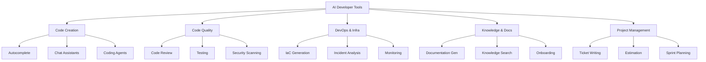

# AI Developer Tool Categories

> A taxonomy of AI tools for engineering teams — beyond just coding assistants.

> **Last verified:** 2026-10-30 · **Re-check by:** 2027-01-30

## The Full Landscape

Most conversations about "AI developer tools" focus on code generation. But the landscape is broader. Here's the complete map:

---

## Category 1: Code Creation Tools

### Autocomplete / Inline Suggestions

**What it does:** Predicts and suggests code as you type. The "tab completion on steroids" experience.

| Tool | Cost | Key differentiator |
|------|------|-------------------|
| GitHub Copilot | 🆓 Free tier / 💰 Paid — [current plans](../ai-coding-agents/agent-landscape.md#github-copilot-agent-mode) | Broadest language and IDE support, GitHub integration; completions don't consume usage credits |
| Kiro *(AWS's successor to Amazon Q Developer, which stopped accepting new signups May 2026)* | 🆓 Free tier / 💰 Paid — [current plans](../ai-coding-agents/agent-landscape.md#kiro-aws--amazon) | AWS-aware, spec-driven workflow option |
| Cursor *(acquired by SpaceX, Aug 2026; sold via "The X Subscription")* | 🆓 Limited / 💰 Paid — [current plans](../ai-coding-agents/agent-landscape.md#cursor-spacex--xai) | Deep codebase indexing, fast tab completion |
| Devin Desktop *(formerly Windsurf, rebranded by Cognition June 2026)* | 🆓 Free tier / 💰 Paid — [current plans](../ai-coding-agents/agent-landscape.md#devin-desktop-formerly-windsurf) | Agent-centric IDE, ties into Cognition's Devin agent |
| Tabnine | 💰 Paid / 🏢 Enterprise | On-premise and air-gapped deployment, privacy focus |

> ✅ **My take:** This category is a commodity. All major options are good enough. Choose based on your ecosystem (GitHub → Copilot, AWS → Kiro), security requirements (on-prem → Tabnine), or IDE preference (Cursor-specific → Cursor). Two of these five changed owner or name in 2026, so re-check vendor terms at every renewal.

> **Note:** These same tools also offer agent/chat capabilities at their paid tiers. For a detailed comparison of agent-mode features, enterprise readiness, and cost-at-scale projections, see [Agent Landscape](../ai-coding-agents/agent-landscape.md).

### Chat Assistants (IDE-integrated)

**What it does:** Conversational AI within your development environment. Ask questions, generate code, explain existing code.

Every major coding tool now includes this. The differentiation is in context awareness (how well it knows your codebase) and model quality.

### Coding Agents

**What it does:** Autonomous multi-step task execution. See [AI Coding Agents](../ai-coding-agents/) for comprehensive coverage.

---

## Category 2: Code Quality Tools

### AI Code Review

**What it does:** Reviews pull requests for bugs, security issues, style violations, and potential improvements.

| Tool | Cost | What it catches |
|------|------|----------------|
| GitHub Copilot (code review) | 💰 Included in Copilot plans, but each review consumes AI credits and GitHub Actions minutes | General issues, summaries |
| Cursor Bugbot | 💰 Usage-based (~$1–1.50 per review, verify) | Bug-focused PR review |
| CodeRabbit | 🆓 Free for OSS / 💰 Per-user plans | Comprehensive review, security, style |
| Sourcery | 🆓 Free for OSS / 💰 Per-user plans | Python-focused, refactoring suggestions |
| Qodo (formerly CodiumAI) | 🆓 Free tier / 💰 Paid plans | Test-focused review, PR suggestions |

*Retired options: Amazon CodeGuru Reviewer entered maintenance mode in November 2025 and is being discontinued. The Amazon Q Developer for GitHub app stops accepting new installations on November 18, 2026 and reaches end of support on January 30, 2027.*

> ✅ **My take:** AI code review is best as a *complement* to human review, not a replacement. Use it to catch the mechanical issues (unused variables, common bugs, security patterns) so human reviewers can focus on design, intent, and correctness.

**🆓 Getting started free:** CodeRabbit and Sourcery both offer free tiers for open-source. Try them on a public repo to evaluate quality before paying.

### AI Testing Tools

**What it does:** Generates tests, finds edge cases, identifies untested paths.

| Tool | Cost | Approach |
|------|------|---------|
| Built-in agent test gen | 🆓/💰 Included in coding tools | General test generation from code |
| Diffblue Cover | 🏢 Enterprise pricing | Java-specific, AI-generated unit tests at scale |
| Qodo (formerly CodiumAI) | 🆓 Free tier / 💰 Paid | Test suggestions during development |

*Ponicode, listed in earlier versions of this page, was acquired by CircleCI in 2022 and is no longer marketed as a standalone product.*

> ✅ **My take:** Test generation from coding agents (Copilot, Claude Code, etc.) is usually good enough. Specialized testing tools make sense only for large Java codebases (Diffblue) or if you need CI-integrated coverage expansion.

### AI Security Scanning

**What it does:** Finds vulnerabilities in code using AI-augmented analysis.

| Tool | Cost | Focus |
|------|------|-------|
| Coding agents with a security-review prompt or skill (Claude Code, Codex, Kiro, Copilot) | 💰 Included in agent plans (consumes usage) | Ad hoc vulnerability review; not a substitute for SAST |
| GitHub Advanced Security + Copilot | 🏢 Enterprise | Autofix for security alerts |
| Snyk + AI | 💰 Per-project pricing | Dependencies + code, AI-assisted fix suggestions |
| Semgrep + AI rules | 🆓 OSS / 💰 Teams | Custom rules, AI-generated fixes |

> ✅ **My take:** Layer AI security on top of existing SAST/SCA. It's not a replacement for your security toolchain — it's an enhancement that reduces noise and suggests fixes.

---

## Category 3: DevOps & Infrastructure Tools

### IaC Generation

**What it does:** Generates infrastructure-as-code (Terraform, CloudFormation, CDK, Pulumi) from natural language descriptions.

| Tool | Cost | Platform |
|------|------|---------|
| Kiro (with AWS MCP servers) | 🆓 Free tier / 💰 Paid tiers | CloudFormation, CDK, Terraform on AWS |
| Pulumi AI | 🆓 Free | Pulumi (multi-cloud) |
| Coding agents (general) | 💰 Various | Any IaC language |

> ✅ **My take:** Good for scaffolding. Dangerous for complex infrastructure without expert review. IaC mistakes have high blast radius — a misconfigured security group or an overly permissive IAM role can expose your entire environment.

**⚠️ Caution:** Always review AI-generated infrastructure code with the same rigor as production application code. Preferably more.

### Incident Analysis & Observability

**What it does:** Interprets logs, suggests root causes, summarizes incidents.

| Tool | Cost | Approach |
|------|------|---------|
| Amazon Q in the AWS Console | 🆓 Included (verify status — Amazon Q Developer IDE plugins reach end of support April 30, 2027) | AWS-specific troubleshooting |
| Datadog AI | 💰 Included in plans | Log analysis, anomaly explanation |
| PagerDuty AI | 💰 Included in plans | Incident summarization, runbook suggestions |

> ✅ **My take:** Helpful but supplementary. Good for reducing mean-time-to-understand during incidents. Not a replacement for operational expertise.

---

## Category 4: Knowledge & Documentation Tools

### Documentation Generation

| Tool | Cost | Approach |
|------|------|---------|
| Coding agents (general) | 💰 Various | Generate docs from code in context |
| Mintlify | 🆓 Free tier / 💰 Paid | AI-powered doc sites |
| Swimm | 💰 Per-user pricing | Auto-maintained docs linked to code |
| Readme.ai | 🆓 Free | README generation from repos |

### Knowledge Search / Internal Q&A

| Tool | Cost | Approach |
|------|------|---------|
| Glean | 🏢 Enterprise | Cross-tool knowledge search |
| Guru | 💰 Per-user | Team knowledge base with AI |
| Coding tool chat | 💰 Various | Ask about your codebase directly |

---

## Category 5: Project Management AI

| Tool | Cost | What it does |
|------|------|-------------|
| Linear + AI | 💰 Included | Issue writing, triage suggestions |
| Jira AI | 💰 Included in Premium | Summarization, smart suggestions |
| GitHub Copilot coding agent *(successor to the retired Copilot Workspace, May 2025)* | 💰 Copilot plan | Issue → code plan → implementation |

> ✅ **My take:** These are early-stage. Useful for drafting and summarization, not yet reliable for autonomous planning or estimation.

---

## Choosing Across Categories

Most teams don't need a tool in every category. Prioritize based on pain:

| Your biggest pain | Start with |
|------------------|-----------|
| Developers write code slowly | Code creation (autocomplete + agents) |
| Code review is a bottleneck | AI code review + agent-generated PR summaries |
| Test coverage is low | Agent test generation (built into coding tools) |
| Documentation is always stale | Agent documentation generation in CI |
| Incidents take too long to resolve | Observability AI features |
| Infrastructure changes are slow | IaC generation (with expert review) |

---

## The Consolidation Trend

The trend is toward **platform consolidation**. Rather than a different AI tool for each category, major platforms are expanding:

- **GitHub Copilot** → Autocomplete + Chat + Agent + Cloud agents + Code Review + Security
- **AWS (Kiro, successor to Amazon Q)** → Autocomplete + Chat + Agent + Specs + IaC
- **OpenAI (Codex inside ChatGPT plans)** → CLI + IDE + Cloud agents, bundled with general-purpose ChatGPT
- **Cursor** → Autocomplete + Chat + Agent + Cloud agents + Code Review

Consolidation is also happening at the vendor level. Cognition acquired Windsurf and rebranded it Devin Desktop (June 2026). SpaceX acquired Cursor (August 2026) and now sells it bundled with Grok and X Premium. Google folded Gemini CLI and Jules into Antigravity.

**Implication:** You may not need 6 different AI tools. One or two platform choices might cover most needs. Evaluate whether a platform approach (fewer vendors, simpler governance) beats best-of-breed (better tool per category, more governance overhead).

---

## Next

- Need a structured evaluation process? → [Evaluation Framework](./evaluation-framework.md)
- Deciding between building custom vs. buying? → [Build vs. Buy](./build-vs-buy.md)
- Deep dive on coding agents specifically? → [AI Coding Agents](../ai-coding-agents/)
